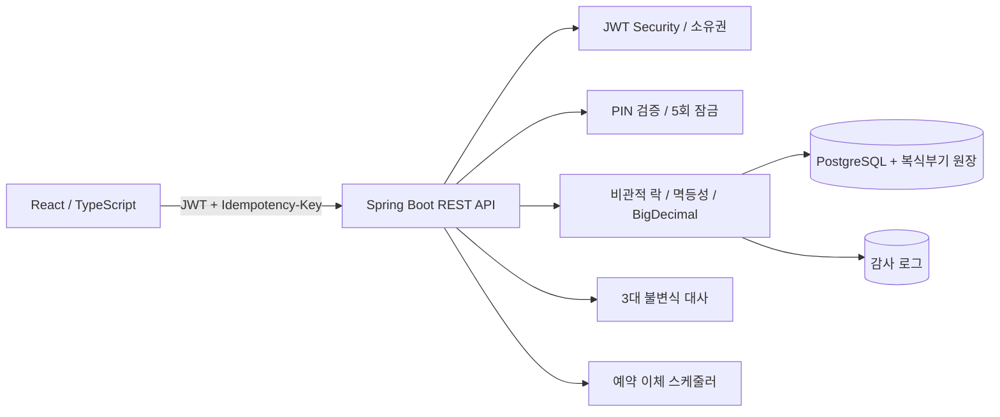

# mini-corebank

원화 코어뱅킹 포트폴리오 프로젝트다. 복식부기 원장, 동시성·멱등성 이체, PIN 잠금, 정합성 대사, 예약 이체, React 데모 화면을 하나의 검증 가능한 시스템으로 구현했다.

## 구현 범위

### 마일스톤 1 — 코어 원장

- 회원가입/JWT 로그인/`USER`·`ADMIN` 권한
- 원화 계좌 개설, 목록/상세 조회, 해지
- 입금·출금·즉시 이체와 계좌별 거래내역
- 모든 거래의 `DEBIT`/`CREDIT` 분개 2줄 기록
- 계좌 ID 정렬 `PESSIMISTIC_WRITE`와 멱등키 재시도 차단
- `SYSTEM-VAULT` 기반 Zero-Sum 원장

### 마일스톤 2 — 금융 심화

- PIN 5회 연속 오류 시 계좌 `LOCKED`, 관리자 잠금 해제
- 거래별 대차, 계좌 잔액-원장 합계, 전체 Zero-Sum 대사
- 대사 결과 이력과 수동/정기 실행
- 예약 이체 등록/조회/취소
- 도래 예약의 행 잠금·내부 멱등키 실행과 `COMPLETED`/`FAILED` 상태 기록

### 마일스톤 3 — 풀스택 데모

- React + TypeScript + Vite 인터넷뱅킹 대시보드
- 계좌 개설/해지, 입출금/즉시 이체, 예약 이체
- 거래내역, 내 감사 로그, 관리자 대사/감사 로그/잠금 해제
- 금전 요청에 UUID `Idempotency-Key` 자동 생성
- 프론트 금액 입력은 원 단위 정수 문자열로 전송

## 핵심 아키텍처



금액은 프론트 입력·백엔드 `BigDecimal`·DB `NUMERIC(19,0)`로 원화 정수 무결성을 유지한다.

## 기술 스택

- Backend: Java 17, Spring Boot 3.x, Spring Security, Spring Data JPA, Flyway
- Database: PostgreSQL 16
- Frontend: React 18, TypeScript, Vite
- Test: Gradle/JUnit 5, Spring Boot Test, H2
- Infra: Docker Compose

## 실행

```bash
docker compose up -d

cd backend
./gradlew bootRun
```

```bash
cd frontend
npm install
npm run dev
```

프론트엔드는 기본 `http://localhost:5173`, 백엔드는 `8080` 기준으로 프록시한다.

데모 관리자:

- 이메일: `admin@corebank.com`
- 비밀번호: `Admin1234!`

운영 환경에서는 기본 관리자 비밀번호와 JWT 시크릿을 환경변수로 교체해야 한다.

## 검증

```bash
cd backend
./gradlew test

cd frontend
npm run build
```

금융 도메인 필수 시나리오는 [`docs/TEST_PLAN.md`](docs/TEST_PLAN.md)를 참고한다.

## 문서와 학습 자료

- 전체 코드베이스 파일 지도: [`docs/study/README.md`](docs/study/README.md)
- 스키마/도메인: [`docs/study/01-schema-and-domain-files.md`](docs/study/01-schema-and-domain-files.md)
- 공통/인증/감사: [`docs/study/02-common-auth-audit-files.md`](docs/study/02-common-auth-audit-files.md)
- 계좌/거래: [`docs/study/03-account-and-transaction-files.md`](docs/study/03-account-and-transaction-files.md)
- 대사: [`docs/study/04-reconciliation-files.md`](docs/study/04-reconciliation-files.md)
- 예약 이체: [`docs/study/05-scheduled-transfer-files.md`](docs/study/05-scheduled-transfer-files.md)
- 프론트엔드: [`docs/study/06-frontend-files.md`](docs/study/06-frontend-files.md)
- 풀스택 최종 가이드: [`docs/study/M3-fullstack-architecture.md`](docs/study/M3-fullstack-architecture.md)
