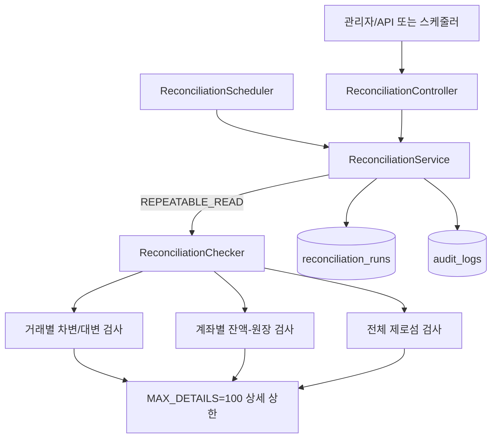
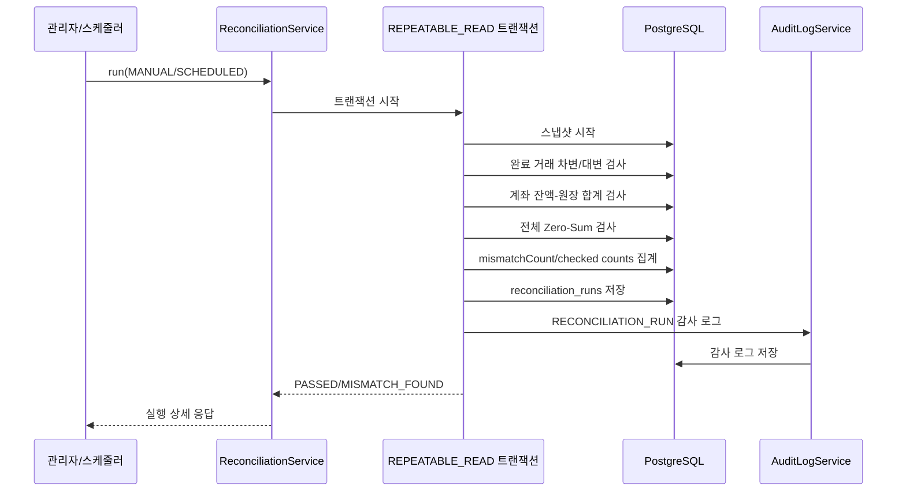

# 정합성 대사(Reconciliation) 전 파일 해설

이 문서는 원장과 계좌 잔액의 3대 불변식을 전수 검사하고, 실행 이력과 감사 증적을 남기는 대사 계층을 설명한다.

## 전체 흐름



## `ReconciliationChecker.java`

- **요약/레이어:** 대사 집계 컴포넌트
- **설계 의도:** 엔티티를 메모리에 올리지 않고 JDBC 집계 쿼리로 3대 불변식을 전수 검사한다.
- **핵심 상수:** `CREDIT_SUM`, `DEBIT_SUM`, `MAX_DETAILS = 100`
- **핵심 타입:** `Result(checkedAccounts, checkedTransactions, mismatchCount, details)`

### `check()`

1. 제로섬 불일치 최대 2건을 먼저 구한다.
2. 전체 거래 불일치 건수를 `COUNT(*)`로 정확히 센다.
3. 거래 불일치 상세를 남은 상한만큼 `LIMIT`으로 읽는다.
4. 전체 계좌 불일치 건수를 다시 정확히 센다.
5. 계좌 불일치 상세를 남은 상한만큼 읽는다.
6. 검사한 계좌 수와 완료 거래 수를 함께 반환한다.

이 순서는 상세 배열을 100건 이하로 제한하면서도 전체 `mismatchCount`는 제한과 무관하게 정확하게 유지하기 위한 설계다.

### 불변식 1 SQL - 거래별 차변/대변

핵심 쿼리는 완료 거래를 분개와 왼쪽 조인하고 거래별로 금액 합계를 비교한다.

```sql
select t.id, t.amount,
       coalesce(sum(case when le.entry_type = 'CREDIT' then le.amount end), 0) credit_total,
       coalesce(sum(case when le.entry_type = 'DEBIT' then le.amount end), 0) debit_total
from transactions t
left join ledger_entries le on le.transaction_id = t.id
where t.status = 'COMPLETED'
group by t.id, t.amount
having credit_total <> t.amount or debit_total <> t.amount
order by t.id
limit 100;
```

- 분개가 아예 없으면 왼쪽 조인된 행의 합계는 0이 된다.
- CREDIT 합계와 DEBIT 합계가 모두 거래 금액과 일치해야 한다.
- 누락 분개와 초과 분개를 모두 탐지할 수 있다.
- `idx_ledger_entries_transaction_id`가 조인과 누락 분개 검사의 핵심이다.

### 불변식 2 SQL - 계좌 잔액과 원장 합계

계좌별 분개를 먼저 원장 순익 `(CREDIT 합계 - DEBIT 합계)`로 묶고, 실제 `accounts.balance`와 비교한다.

```sql
select a.id, a.account_number, a.balance,
       coalesce(l.credit_total, 0) - coalesce(l.debit_total, 0) as ledger_net
from accounts a
left join (
  select le.account_id,
         sum(case when le.entry_type = 'CREDIT' then le.amount end) credit_total,
         sum(case when le.entry_type = 'DEBIT' then le.amount end) debit_total
  from ledger_entries le
  group by le.account_id
) l on l.account_id = a.id
where a.balance <> coalesce(l.credit_total, 0) - coalesce(l.debit_total, 0)
order by a.id;
```

- 고객 계좌와 `SYSTEM-VAULT`를 모두 검사한다.
- 불일치 항목에는 expected 원장 순익, actual 계좌 잔액, 차액을 담는다.
- 계좌번호는 응답 전에 마스킹한다.

### 불변식 3 SQL - 전체 Zero-Sum

두 가지를 별도로 검사한다.

1. 전체 계좌 잔액 합계가 0인지 확인한다.
2. 전체 분개의 CREDIT 합계와 DEBIT 합계가 같은지 확인한다.

불일치가 각각 있으면 `ZERO_SUM_MISMATCH`를 최대 2건까지 추가한다. 전체 잔액 합계 불일치와 분개 합계 불일치는 서로 다른 원인이므로 각각 상세를 남긴다.

### 면접 포인트

- 왜 대사 쿼리는 전체 데이터를 애플리케이션에 올리지 않고 SQL 집계로 처리하는가?
- 상세 100건 상한과 전체 mismatchCount를 분리하는 이유는 무엇인가?

## `ReconciliationService.java`

- **요약/레이어:** 대사 실행/이력 Service
- **핵심 메서드:** `run`, `list`, `get`, `toJson`, `fromJson`
- **핵심 어노테이션:** `@Transactional(isolation = Isolation.REPEATABLE_READ)`

### `run(triggerType, executedBy, clientIp)`

1. 하나의 `REPEATABLE_READ` 트랜잭션을 연다.
2. `ReconciliationChecker.check()`로 세 불변식을 검사한다.
3. mismatchCount가 0이면 `PASSED`, 아니면 `MISMATCH_FOUND`다.
4. 상세 배열을 JSON으로 직렬화한다.
5. `reconciliation_runs`에 이력을 저장한다.
6. `RECONCILIATION_RUN` 감사 로그를 같은 트랜잭션에 기록한다.
7. 실행 결과와 상세를 응답한다.

`REPEATABLE_READ`는 여러 집계 쿼리 사이에 다른 트랜잭션 커밋을 혼합해 오탐을 만들지 않도록 스냅샷을 유지한다.

### `list(page,size)`

- `PageParams.validate`로 page/size를 검증한다.
- `executedAt DESC, id DESC`로 최신순을 만든다.
- 상세 JSON을 내려주지 않고 요약만 내려 대용량 응답을 막는다.

### `get(id)`

- 이력 ID로 단건을 조회한다.
- 없으면 `RECONCILIATION_RUN_NOT_FOUND`를 반환한다.
- 저장된 `details_json`을 `ReconciliationMismatch` 목록으로 역직렬화한다.

### 면접 포인트

- 왜 대사에 계좌 행 잠금이 아니라 읽기 격리 스냅샷을 사용하는가?
- 스냅샷 동안 실제 거래가 계속 커밋되어도 불일치로 오판하지 않게 하는 방법은 무엇인가?

## `ReconciliationController.java`

- **요약/레이어:** 관리자 REST Controller
- **핵심 메서드:** `run`, `list`, `get`
- **핵심 엔드포인트:**
  - `POST /api/admin/reconciliations/run`
  - `GET /api/admin/reconciliations`
  - `GET /api/admin/reconciliations/{id}`
- **권한:** `/api/admin/**`가 `ROLE_ADMIN`으로 제한한다.
- **설계 의도:** 수동 실행은 관리자 ID와 IP를 전달하고, 이력 조회는 인증된 관리자만 사용한다.
- **면접 포인트:** 컨트롤러 권한 체크와 계층 내 권한 검증을 중복할 필요가 있는가?

## `ReconciliationScheduler.java`

- **요약/레이어:** 정기 배치 컴포넌트
- **핵심 메서드:** `runScheduledReconciliation`
- **핵심 어노테이션:** `@Scheduled(cron = "${corebank.reconciliation.cron:0 0 2 * * *}")`
- **설계 의도:** 기본 매일 02:00에 `SCHEDULED` 대사를 실행한다.
- **핵심 동작:** mismatch가 있으면 경고 로그를 남기고, 없으면 통과 로그를 남긴다.
- **연결:** `ReconciliationService.run(SCHEDULED, null, null)`
- **면접 포인트:** 다중 인스턴스에서 스케줄러 중복 실행을 분산 락이나 단일 잡으로 막는 방법은 무엇인가?

## `SchedulingConfig.java`

- **요약/레이어:** 스케줄링 설정
- **핵심 어노테이션:** `@Configuration`, `@EnableScheduling`
- **설계 의도:** 애플리케이션에 `@Scheduled` 프로세스를 활성화한다.
- **연결:** `ReconciliationScheduler`
- **면접 포인트:** 스케줄러를 기능 플래그나 프로필로 왜 분리할 수 있는가?

## DTO와 응답

### `ReconciliationMismatch.java`

- **요약/레이어:** 불일치 상세 DTO
- **핵심 상수:** `TX_BALANCE_MISMATCH`, `ACCOUNT_LEDGER_MISMATCH`, `ZERO_SUM_MISMATCH`
- **핵심 필드:** 유형, 설명, 거래/계좌 ID, 마스킹 계좌번호, expected/actual/credit/debit/difference
- **설계 의도:** 유형별로 필요한 필드만 채우고 나머지는 JSON에서 제외한다.
- **면접 포인트:** 오류 상세에 원본 계좌번호를 넣지 않고 마스킹하는 이유는 무엇인가?

### `ReconciliationRunResponse.java`

- **요약/레이어:** 대사 상세 응답 DTO
- **핵심 필드:** 실행 ID, 주체, 상태, 검사 수, mismatchCount, 상세 목록, 실행자, 시각
- **설계 의도:** 단건 조회와 수동 실행 응답에 같은 스키마를 사용한다.
- **연결:** `ReconciliationService.toResponse`

### `ReconciliationRunSummary.java`

- **요약/레이어:** 대사 목록 요약 DTO
- **핵심 메서드:** `from`
- **설계 의도:** 상세 JSON 대신 목록에 필요한 실행 요약만 제공한다.
- **연결:** `ReconciliationRunRepository`, `PageResponse`
- **면접 포인트:** 목록 API에서 상세 JSON을 제외해 응답 크기와 직렬화 비용을 줄이는 이유는 무엇인가?

## REPEATABLE_READ 대사 시퀀스



## MAX_DETAILS 상한 설계

현재 구현의 상한은 `MAX_DETAILS = 100`이다.

- 제로섬 불일치 최대 2건을 먼저 담는다.
- 거래 불일치 건수와 계좌 불일치 건수는 `COUNT(*)`로 전수 집계한다.
- 상세 조회는 `LIMIT`으로 남은 공간만큼만 읽는다.
- 따라서 응답과 `details_json`은 최대 100건 이하로 제한된다.
- 전체 불일치 건수는 상세 배열 길이와 별개로 정확하게 저장된다.

이 상한은 대량 부패가 발생해도 대사 실행이 메모리와 저장소 폭증을 일으키지 않도록 보호한다.

## 면접 Q&A

**Q1. 대사는 왜 거래마다 락을 잡지 않는가?**  
운영 중 계좌 락을 잡으면 금융 거래가 멈춘다. 대사는 읽기 전용 집계와 `REPEATABLE_READ` 스냅샷으로 원장 상태를 안정적으로 점검한다.

**Q2. 3대 불변식은 각각 무엇을 검사하는가?**  
거래별 대차 일치, 계좌 잔액과 원장 순익 일치, 전체 잔액과 분개 합계의 Zero-Sum 일치를 검사한다.

**Q3. mismatchCount와 details 배열은 왜 분리되는가?**  
상세는 최대 100건으로 제한할 수 있지만 운영 보고의 전체 불일치 건수는 정확히 알아야 하기 때문이다.

**Q4. 왜 인덱스를 조인 키별로 두는가?**  
거래별 검사는 `transaction_id`, 계좌별 검사는 `account_id`를 사용하므로 조인과 집계를 반복 스캔하지 않도록 인덱스를 둔다.

**Q5. 대사 스케줄러는 어떤 격리 전략이 필요한가?**  
단일 인스턴스가 아니라면 분산 락 또는 단일 실행 잡으로 같은 시각의 중복 대사를 막아야 한다.

**Q6. 대사 결과가 불일치해도 감사 로그는 성공인가?**  
대사 실행 자체가 정상 종료되었고 불일치는 결과 상태이므로 실행 성공 감사 로그를 남긴다. 불일치 건수는 응답과 이력에서 별도로 증적한다.
