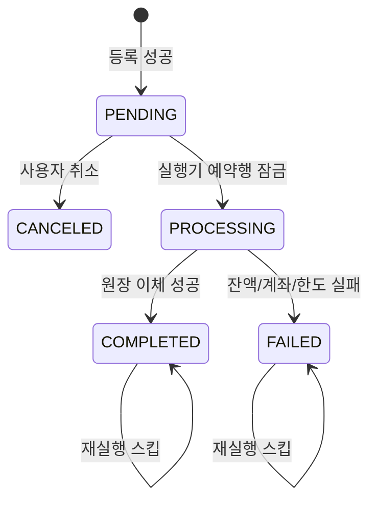
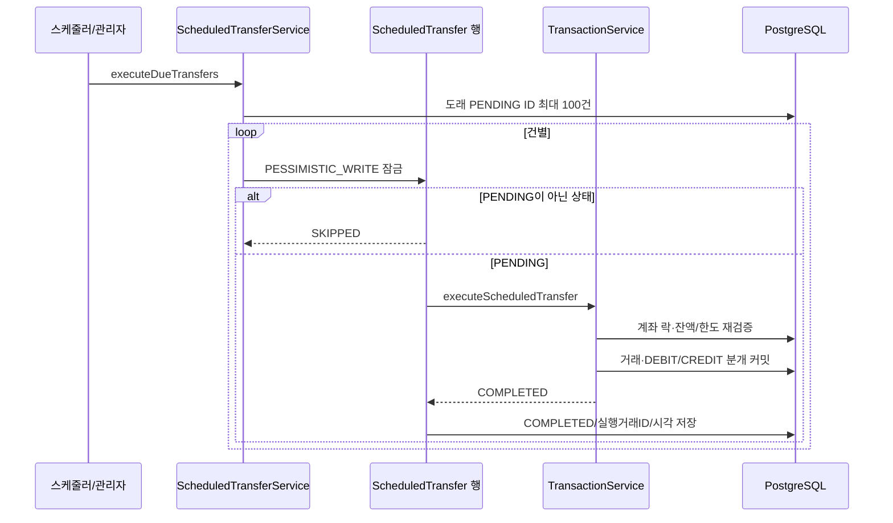

# 예약 이체(Scheduled Transfer) 전 파일 해설

예약 이체는 PENDING 등록 → 도래 실행 → 원장 이체 또는 FAILED 상태 전환을 수행한다.

## `ScheduledTransferController.java`

- **요약/레이어:** 고객 예약 이체 REST Controller
- **핵심 메서드:** `create`, `list`, `cancel`
- **주요 경로:** `POST /api/scheduled-transfers`, `GET /api/scheduled-transfers`, `POST /api/scheduled-transfers/{id}/cancel`
- **설계 의도:** 인증 주체와 멱등키 헤더를 서비스에 전달한다.
- **연결:** `ScheduledTransferService`
- **면접 포인트:** 예약 등록은 왜 즉시 출금하지 않고 PENDING으로 저장하는가?

## `AdminScheduledTransferController.java`

- **요약/레이어:** 관리자 실행 REST Controller
- **핵심 메서드:** `executeDue`
- **경로:** `POST /api/admin/scheduled-transfers/execute-due`
- **권한:** `/api/admin/**`에서 ADMIN으로 제한
- **설계 의도:** 스케줄러와 같은 실행 엔진을 수동 트리거한다.
- **면접 포인트:** 스케줄러와 관리자 수동 실행이 같은 멱등 엔진을 써야 하는 이유는 무엇인가?

## `ScheduledTransferScheduler.java`

- **요약/레이어:** 예약 실행 스케줄러
- **핵심 메서드:** `executeDueTransfers`
- **핵심 어노테이션:** `@Scheduled(fixedDelayString = "${corebank.scheduler.transfer-delay-ms:30000}")`
- **설계 의도:** 30초 간격으로 도래 예약을 조회한다.
- **멀티 인스턴스 방어:** 예약 행 PESSIMISTIC_WRITE와 PENDING 재확인이 중복 실행을 막는다.
- **연결:** `ScheduledTransferService.executeDueTransfers`
- **면접 포인트:** fixed delay와 fixed rate의 차이와 장애 시 재시도는 무엇인가?

## `ScheduledTransferService.java`

- **요약/레이어:** 예약 이체 핵심 Service
- **핵심 상수:** `MAX_BATCH_SIZE = 100`
- **핵심 메서드:** `create`, `save`, `listMine`, `cancel`, `executeDueTransfers`, `executeOne`, `markFailedSafely`, `markFailed`, `replay`

### 등록 흐름

1. 금액과 예약 시각을 검증한다.
2. 입금 계좌를 조회하고 같은 계좌를 차단한다.
3. 멱등키와 요청 해시를 검증한다.
4. `AccountPinVerificationService`로 등록 시 PIN을 독립 트랜잭션 검증한다.
5. 멱등 응답이 있으면 재생한다.
6. 출금 계좌 소유권/ACTIVE 상태와 1회 한도를 검증한다.
7. PENDING 예약과 멱등 응답/감사 로그를 저장한다.

등록은 계좌 잔액을 당일차감하지 않는다.

### 조회·취소

- `listMine`은 본인 예약만 최신순 페이징하고 선택적 status 필터를 적용한다.
- `cancel`은 예약 행을 PESSIMISTIC_WRITE로 잠그고 본인 소유와 PENDING 상태를 확인한 뒤 CANCELED로 바꾼다.
- 이미 COMPLETED/FAILED/CANCELED면 INVALID_INPUT을 반환한다.

### 도래 건 실행

도래 조회는 `MAX_BATCH_SIZE=100`로 오래된 순 최대 100건만 처리한다. 예약 행은 다시 PESSIMISTIC_WRITE로 잠그고 PENDING인지 재확인한다. 내부 멱등키는 `SCHED-TX-{scheduledTransfer.id}`다.

### 실패 격리

- 원장 검증 실패는 호출 거래 트랜잭션을 롤백한다.
- 별도 트랜잭션에서 예약 상태를 FAILED로 바꾸고 failureReason을 ErrorCode 이름으로 저장한다.
- 감사 로그는 SCHEDULED_TRANSFER_EXEC FAILURE로 남는다.
- FAILED 상태 기록 자체가 일시적으로 실패하면 PENDING을 유지하고 다음 주기에 재시도한다.
- 한 건의 실패가 다른 건 루프를 막지 않도록 건별 예외 격리를 한다.

### 면접 포인트

- 예약 이체는 왜 상태 전환과 원장 커밋을 같은 트랜잭션에서 해야 하는가?
- 멱등키를 쓰는 동시에 예약 행 잠금이 필요한 이유는 무엇인가?

## `ScheduledTransferRepository.java`

- **요약/레이어:** 예약 이체 Repository
- **핵심 메서드:** `findDueIds`, `findByIdForUpdate`, `findByUserId`, `findByUserIdAndStatus`
- **핵심 쿼리:** PENDING이고 scheduledAt <= now인 ID를 scheduledAt/id 순서로 Pageable 조회
- **핵심 어노테이션:** `@Lock(PESSIMISTIC_WRITE)`
- **인덱스:** `idx_scheduled_transfers_status_scheduled_id(status, scheduled_at, id)`
- **면접 포인트:** 엔티티 전체가 아닌 도래 ID만 조회하는 이유는 락과 상태 재확인 전에 불필요한 영속성 캐시를 줄이기 위해서다.

## `TransactionService.executeScheduledTransfer`

- **요약/레이어:** 예약 이체 전용 거래 메서드
- **트랜잭션:** `Propagation.MANDATORY`
- **핵심 흐름:**
  1. 내부 멱등키로 기존 거래를 조회한다.
  2. 기존 거래가 있으면 출발 계좌/도착 계좌/금액이 예약과 일치하는지 검증한다.
  3. 계좌를 ID 오름차순으로 PESSIMISTIC_WRITE 잠금한다.
  4. 소유권/ACTIVE 상태/잔액/일일 한도를 재검증한다.
  5. DEBIT/CREDIT 분개 2줄을 기록한다.
- **설계 의도:** 예약 실행도 일반 즉시 이체와 같은 원장 불변식을 공유한다.
- **면접 포인트:** 실행 시점의 계좌 상태를 왜 재검증해야 하는가?

## DTO

### `CreateScheduledTransferRequest`

- 출발 계좌, 입금 계좌 번호, 금액, PIN, 예약 시각, 설명을 받는다.
- PIN은 `toString`에서 노출하지 않는다.
- 설명은 멱등 해시에만 반영되고 scheduled_transfers 테이블에는 별도 컬럼이 없다.

### `ScheduledTransferResponse`

- 예약 ID, 출발 계좌, 마스킹된 입금 계좌, 금액, 예약 시각, 상태, 실패 사유, 실행 거래 ID와 시각을 반환한다.

### `ScheduledExecutionSummary`

- one batch의 due/completed/failed/skipped 건수를 요약한다.
- skipped는 이미 처리됨, 취소됨, 일시 오류로 다음 주기 재시도 등 다양한 사유를 포함한다.

## 면접 Q&A 6선

**Q1. 예약 이체와 즉시 이체의 차이는 무엇인가?**  
즉시 이체는 요청 시 원장을 변경하지만 예약 이체는 먼저 PENDING을 저장하고 도래 시점에 원장 규칙을 다시 검증한다.

**Q2. 스케줄러 중복 실행을 어떻게 막는가?**  
예약 행을 PESSIMISTIC_WRITE로 잠그고 PENDING 재확인을 한 뒤 내부 멱등키로 원장을 보호한다.

**Q3. 실패한 예약은 원장을 어떻게 처리하는가?**  
실패 검증은 본 실행 트랜잭션을 롤백하고 별도 트랜잭션으로 FAILED와 failureReason을 커밋한다.

**Q4. 실행 시점 재검증이 필요한 이유는 무엇인가?**  
예약 등록 이후 잔액, 계좌 상태, 일일 한도가 변할 수 있기 때문이다.

**Q5. 배치 성능은 어떻게 제한하는가?**  
MAX_BATCH_SIZE=100과 scheduled_at/id 복합 인덱스로 한 주기 처리량을 제한한다.

**Q6. 상태가 FAILED이면 왜 다시 실행하지 않는가?**  
실행 결과가 확정되었기 때문에 잔액 부족/잠금 상태가 변하지 않은 경우 반복 차감과 중복 시도를 방지한다.
