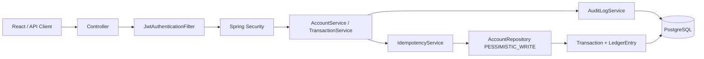
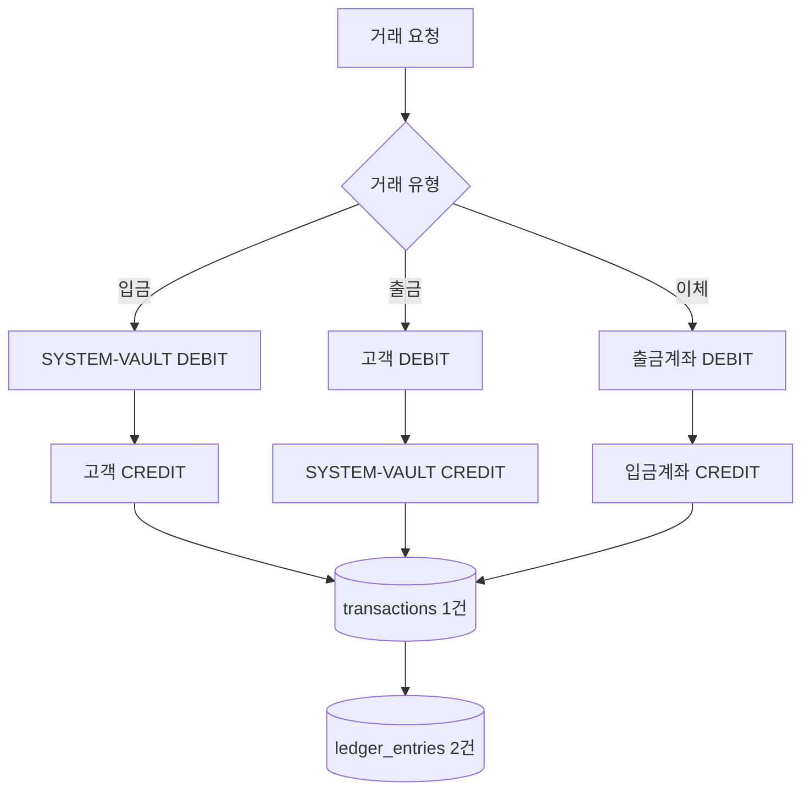
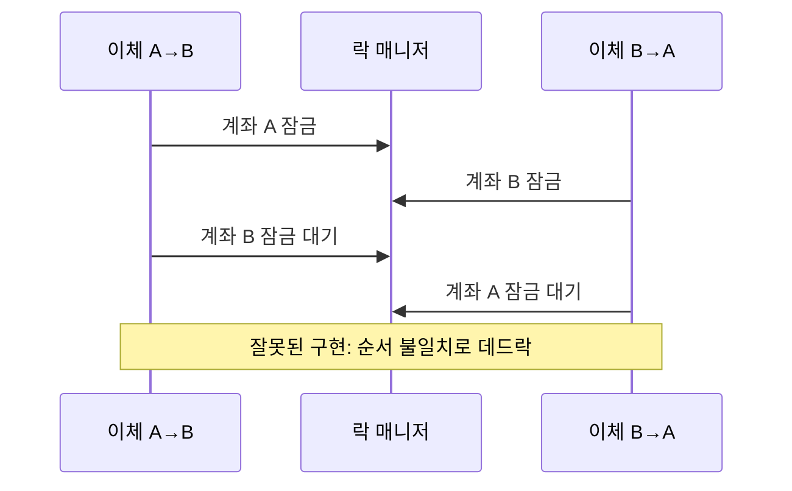
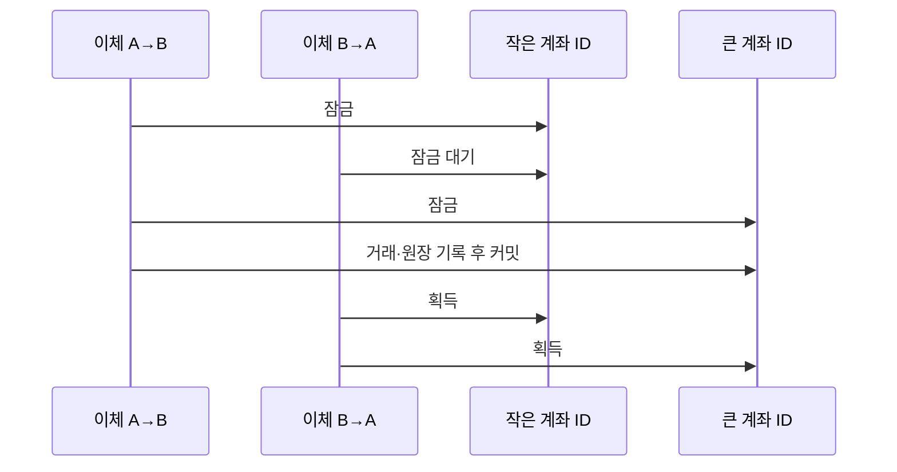
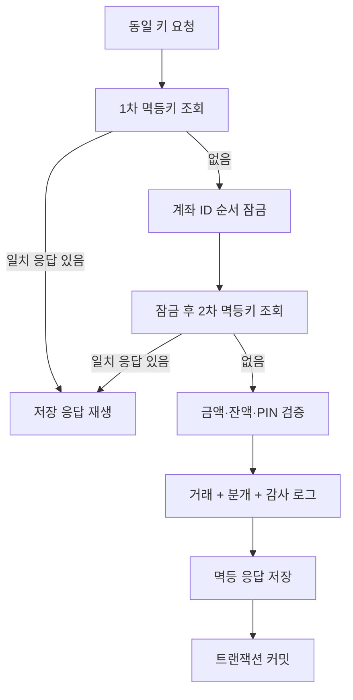
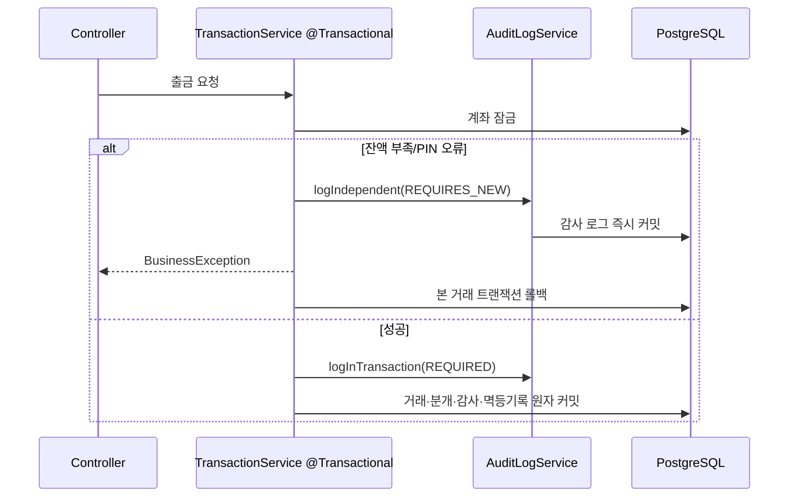

# 마일스톤 1 코어 원장 코드 리딩 가이드

이 문서는 복식부기 원장, 동시성, 멱등성, 감사 로그를 한 번에 이해하기 위한 학습 자료다.

## 1. 전체 아키텍처



### 패키지 지도

| 패키지/파일 | 역할 |
|---|---|
| `auth/**` | 회원가입, 로그인, JWT 발급/검증 |
| `config/SecurityConfig.java` | Stateless Security와 역할별 접근 제어 |
| `account/**` | 계좌 개설, 조회, 해지 |
| `transaction/**` | 입출금/이체 비즈니스 규칙과 거래내역 |
| `common/idempotency/**` | 멱등키와 요청 해시 |
| `audit/**` | 성공/실패 감사 로그 |
| `domain/**` | JPA 엔티티와 Repository |
| `V1__init_schema.sql` | 8개 핵심 테이블과 제약 |

## 2. 복식부기 원장과 SYSTEM-VAULT

모든 금전 이동은 한 거래에 DEBIT 1건과 CREDIT 1건을 남긴다.

| 거래 | DEBIT | CREDIT |
|---|---|---|
| 입금 | `SYSTEM-VAULT` 잔액 감소 | 고객 계좌 잔액 증가 |
| 출금 | 고객 계좌 잔액 감소 | `SYSTEM-VAULT` 잔액 증가 |
| 이체 | 출금 고객 계좌 잔액 감소 | 입금 고객 계좌 잔액 증가 |



예를 들어 고객 A가 50,000원을 입금하면 시재는 `-50,000`, 고객은 `+50,000`이다. 전체 합계는 `-50,000 + 50,000 = 0`이다. 출금하면 방향이 반대가 되어 다시 전체 합계가 0을 유지한다.

### 핵심 코드: 분개 기록

`TransactionService.java:166-178`

```java
Transaction tx = transactionRepository.save(...);
debitAccount.debit(amount);
creditAccount.credit(amount);
ledgerEntryRepository.save(new LedgerEntry(... DEBIT ...));
ledgerEntryRepository.save(new LedgerEntry(... CREDIT ...));
```

- 거래 헤더 1건을 먼저 만들고 분개가 같은 테이블에서 참조하도록 한다.
- Debit 계좌는 잔액을 감소하고 그 시점의 `balance_after`를 분개에 저장한다.
- Credit 계좌는 잔액을 증가하고 두 분개 금액 합이 거래 금액과 같다.
- 세 엔티티의 변경과 멱등성 기록은 하나의 `@Transactional`로 커밋된다.

## 3. 동시성 제어와 데드락 방지

`AccountRepository.findByIdForUpdate`는 `PESSIMISTIC_WRITE`로 행을 잠근다. `TransactionService.lockInOrder`는 모든 계좌 ID를 정렬한 뒤 작은 ID부터 잠근다.





잠금 전에 엔티티를 영속성 컨텍스트에 먼저 올리면 이후 `FOR UPDATE`가 1차 캐시의 오래된 값으로 동작할 수 있으므로, 계좌 번호에서 ID만 먼저 조회하고 `findByIdForUpdate`로 행을 새로 잠근다.

## 4. 멱등성과 SHA-256

네트워크 타임아웃이 발생하면 같은 요청이 재전송될 수 있다.



요청 해시는 계좌, 대상, 금액, 설명 등의 핵심 필드를 문자열로 결합해 SHA-256으로 만든다. PIN은 별도로 해시 입력에서 제외한다. 현재 구현의 주의점은 PIN은 응답 재생 전에 별도 검증이 필요하도록 멱등성 흐름을 보강해야 한다는 것이다. 자세한 위험은 리뷰 문서의 `RV-M1-02`를 확인한다.

## 5. 트랜잭션 전파와 감사 로그



`REQUIRED` 감사 로그는 호출 트랜잭션을 그대로 따른다. 성공 거래가 커밋되면 감사 로그도 커밋되지만 거래가 실패하면 롤백된다. `REQUIRES_NEW`는 별도 트랜잭션을 열어 실패 로그를 본 거래와 무관하게 남긴다.

## 6. 30분 코드 리딩 로드맵

| 시간 | 단계 | 읽을 파일 | 확인 포인트 |
|---|---|---|---|
| 0~5분 | 스키마/도메인 | `V1__init_schema.sql`, `domain/account/Account.java`, `domain/ledger/LedgerEntry.java` | 금액 타입, 상태, Append-Only 필드 |
| 5~10분 | 멱등/감사 | `IdempotencyService.java`, `AuditLogService.java`, `MaskingUtil.java` | 키 충돌, SHA-256, 독립 트랜잭션 |
| 10~15분 | 인증/시드 | `JwtTokenProvider.java`, `JwtAuthenticationFilter.java`, `SecurityConfig.java`, `SystemSeedInitializer.java` | Stateless 인증과 역할 통제 |
| 15~25분 | 계좌/이체 | `AccountService.java`, `TransactionService.java` | 소유권, 락 순서, 분개, 한도 |
| 25~30분 | 조회/테스트 | `TransactionHistoryService.java`, 동시성·멱등성 테스트 | 필터, 페이징, 데드락/초과출금 검증 |

## 7. 1금융권 기술 면접 Q&A 6선

**Q1. 복식부기 원장이 왜 필요한가?**  
단순 잔액 변경만으로는 거래의 출처와 목적지를 증명하기 어렵기 때문이다. 이 프로젝트는 거래별로 DEBIT/CREDIT 2분개를 기록해 대차 일치와 Zero-Sum 대사를 가능하게 한다.

**Q2. 동시 출금에서 Lost Update를 어떻게 막는가?**  
계좌를 `PESSIMISTIC_WRITE`로 잠그고 잔액 검증과 갱신을 같은 트랜잭션에서 수행한다. 동시에 같은 계좌를 수정하는 요청은 직렬화되어 초과 출금이 발생하지 않는다.

**Q3. 교차 이체 데드락을 어떻게 방지하는가?**  
두 계좌를 항상 ID 오름차순으로 잠근다. A→B와 B→A 요청이 서로 다른 순서로 락을 잡는 상황을 제거한다.

**Q4. 멱등성 키는 왜 필요한가?**  
네트워크 타임아웃 재시도로 같은 이체가 두 번 실행되는 것을 막는다. 키와 사용자/엔드포인트/요청 해시가 일치하면 저장된 응답을 재생하고, 다르면 409를 반환한다.

**Q5. 실패 거래의 감사 로그는 왜 본 트랜잭션과 분리하는가?**  
잔액 부족이나 PIN 오류는 본 거래가 롤백되지만 보안 감사 기록은 남아야 한다. `REQUIRES_NEW`를 사용해 별도 트랜잭션으로 즉시 커밋한다.

**Q6. 원장과 계좌 잔액의 정합성을 어떻게 검증하는가?**  
거래별 CREDIT 합과 DEBIT 합이 일치하는지, 계좌 잔액이 해당 계좌 분개 합과 일치하는지, 전체 계좌 잔액 합이 0인지 세 가지 불변식을 점검한다.
