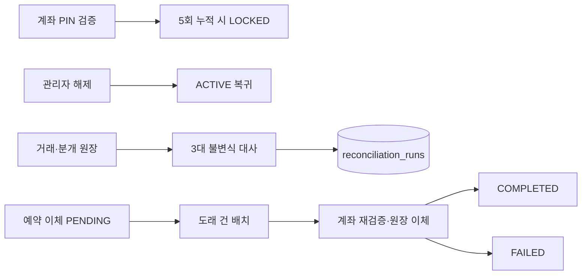
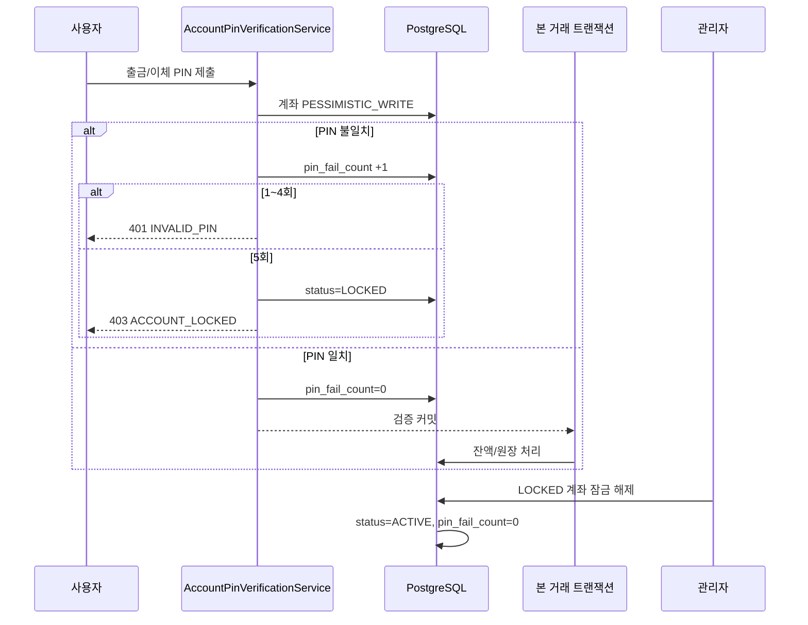
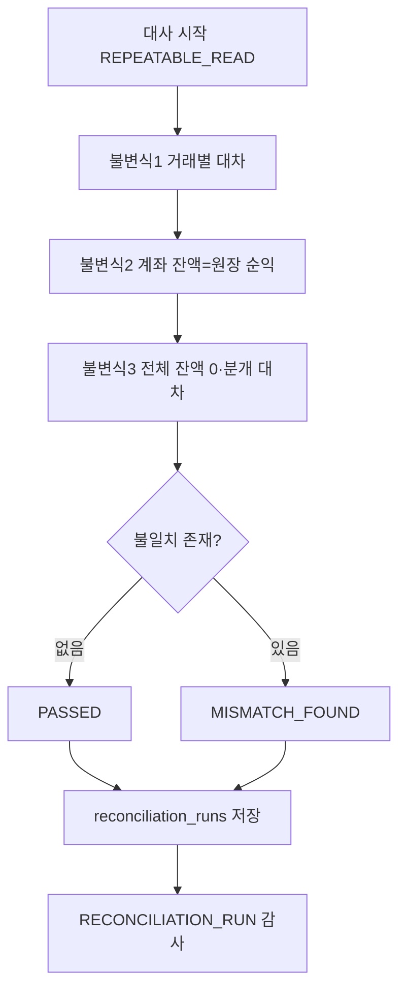
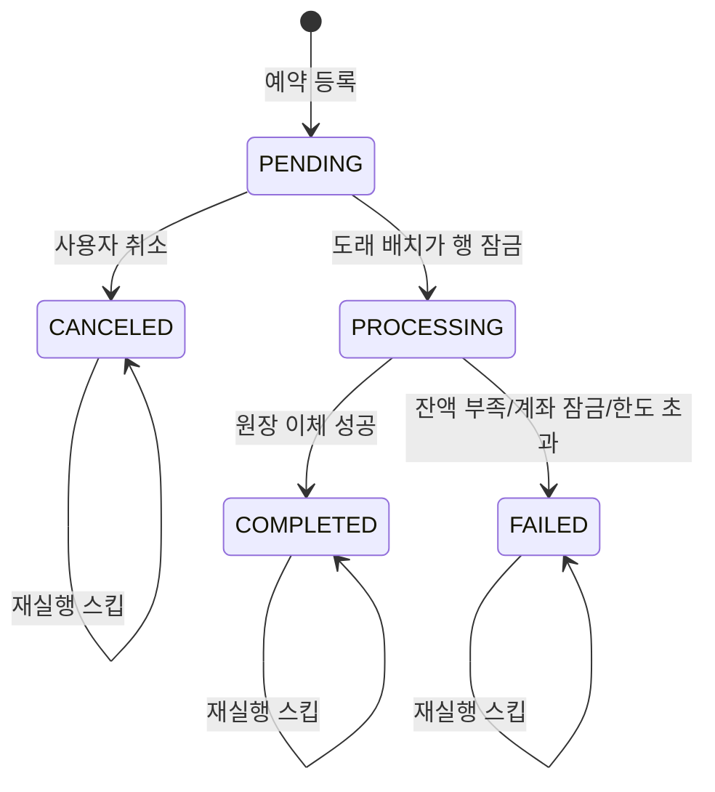

# 마일스톤 2 코어뱅킹 심화 학습 가이드

마일스톤 2는 PIN 잠금, 원장-잔액 대사, 예약 이체라는 세 가지 운영 품질 기능을 다룬다.

## 전체 흐름

## 1. PIN 5회 잠금과 관리자 해제

핵심은 PIN 실패 집계를 본 출금 트랜잭션과 분리하는 것이다. `REQUIRES_NEW + noRollbackFor=BusinessException`으로 실패 카운트와 잠금 상태를 먼저 커밋한 뒤 원래 요청 예외를 던진다.

## 2. 원장-잔액 대사

불변식은 다음과 같다.

| 불변식 | 검증식 | 탐지 코드 |
|---|---|---|
| 거래 대차 | CREDIT 합 = DEBIT 합 = transaction.amount | TX_BALANCE_MISMATCH |
| 계좌 정합성 | accounts.balance = CREDIT 합 - DEBIT 합 | ACCOUNT_LEDGER_MISMATCH |
| 전체 Zero-Sum | 전체 잔액 합 = 0, 전체 CREDIT 합 = DEBIT 합 | ZERO_SUM_MISMATCH |

대사 상세는 최대 100건으로 제한하고 전체 mismatchCount는 COUNT로 정확히 집계한다. 계좌번호는 마스킹한다.

## 3. 예약 이체 상태머신

도래 배치는 다음 순서로 실행한다.

1. PENDING이고 scheduledAt <= now인 예약을 오래된 순 최대 100건 조회한다.
2. 예약 행을 PESSIMISTIC_WRITE로 잠그고 PENDING 재확인한다.
3. 내부 멱등키 `SCHED-TX-{id}`로 즉시 이체 엔진을 호출한다.
4. 실행 시점 잔액/한도/계좌 상태를 재검증한다.
5. 성공하면 COMPLETED와 실행 거래 ID를 저장하고, 실패하면 원장 트랜잭션을 롤백한 뒤 FAILED와 failureReason을 별도 커밋한다.

## 핵심 코드 라인별 해설

- `AccountPinVerificationService.verify`: 계좌 행 잠금 → 소유권/상태 → PIN 일치/불일치 → 5회 잠금
- `ReconciliationChecker.check`: 세 불변식 집계 → mismatchCount와 최대 100건 상세
- `ReconciliationService.run`: REPEATABLE_READ 스냅샷 → 이력 저장 → 감사 로그
- `ScheduledTransferRepository.findDueIds`: 도래 PENDING ID를 배치 크기와 정렬로 조회
- `ScheduledTransferService.executeOne`: 예약 행 잠금 → 원장 실행 → COMPLETED 또는 FAILED
- `TransactionService.executeScheduledTransfer`: 내부 멱등키 검증 → 계좌 락 → 상태/한도/잔액 재검증 → 분개

## 30분 코드 리딩 로드맵

| 시간 | 읽는 파일 | 확인 포인트 |
|---|---|---|
| 0~5분 | `Account.java`, `AccountPinVerificationService.java` | 상태 전이와 pin_fail_count |
| 5~10분 | `TransactionService.java`의 withdraw/transfer | PIN 선검증과 본 거래 트랜잭션 분리 |
| 10~16분 | `ReconciliationChecker.java` | 3대 불변식 SQL |
| 16~20분 | `ReconciliationService.java` | 스냅샷과 이력 저장 |
| 20~26분 | `ScheduledTransferService.java` | 상태머신과 실패 격리 |
| 26~30분 | Pin/Reconciliation/Scheduled 테스트 | 검증 시나리오와 중복 방지 |

## 1금융권 기술 면접 Q&A 6선

**Q1. PIN 실패 카운트는 왜 본 거래 트랜잭션과 분리하는가?**  
잘못된 PIN이나 잔액 부족으로 본 거래가 롤백되더라도 보안 실패 기록과 pin_fail_count는 남아야 하기 때문이다.

**Q2. 5회 연속 실패는 어떻게 보장하는가?**  
계좌 행을 비관적 락으로 직렬화해 pin_fail_count를 동시에 증가시키고, 성공 PIN 시 카운트를 0으로 초기화한다.

**Q3. 대사는 왜 락을 잡지 않고 실행하는가?**  
운영 중 모든 계좌를 잠그면 거래가 멈추기 때문이다. REPEATABLE_READ 스냅샷으로 원장과 잔액을 일관된 시점에 집계한다.

**Q4. 대사에서 mismatchCount와 상세 수가 왜 다를 수 있는가?**  
응답 크기와 저장 비용을 제한하기 위해 상세는 최대 100건이지만 전체 불일치 건수는 COUNT로 정확히 집계하기 때문이다.

**Q5. 예약 이체 중복 실행을 어떻게 막는가?**  
예약 행 PESSIMISTIC_WRITE 재확인과 SCHED-TX-{id} 내부 멱등키를 동시에 사용한다.

**Q6. 예약 실행 실패를 어떻게 처리하는가?**  
원장 트랜잭션을 롤백한 뒤 별도 트랜잭션에서 FAILED와 failureReason을 커밋하며, 거래 롤백과 상태 커밋이 섞이지 않도록 분리한다.
