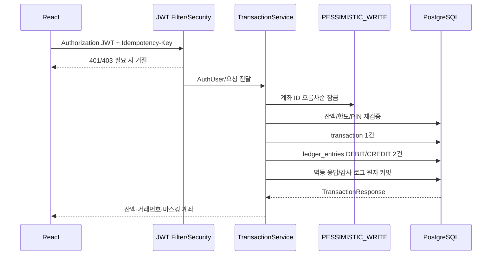

# 마일스톤 3 풀스택 아키텍처 & 면접 최종 가이드

mini-corebank는 브라우저 → Spring REST → JPA/JDBC → PostgreSQL 원장으로 이어지는 일관된 금융 시스템이다.

## 엔드투엔드 금액과 거래 흐름

```mermaid
flowchart LR
    UI[React 입력 문자열] -->|금액 문자열| API[Spring DTO BigDecimal]
    API -->|scale=0 원 단위| Domain[Account.balance NUMERIC]
    Domain -->|DEBIT/CREDIT| Ledger[(ledger_entries NUMERIC)]
    Ledger --> DB[(PostgreSQL NUMERIC(19,0))]
    DB -->|JSON 숫자/잔액| API
    API -->|preserveMoneyLiterals 문자열 보존 + BigInt| UI
```

요청은 프론트 문자열로 전송해 JavaScript의 소수점 변환을 피한다. 백엔드가 `BigDecimal`과 DB `NUMERIC(19,0)`로 원화 정수를 검증하며, 응답 역시 프론트의 `preserveMoneyLiterals`가 `JSON.parse` 전에 금액 리터럴을 문자열(`Money = string`)로 보존하고 `BigInt`로 합산·포맷팅하여 19자리 전 구간 무오차를 보장한다.

## 요청 시퀀스 예시: 즉시 이체



## 풀스택 설계 포인트

### 프론트엔드

- React는 화면 상태와 입력 검증을 담당한다.
- 금전 요청은 원 단위 정수 문자열로 전송한다.
- 금액 표시와 합산은 `normalizeAmount`, `BigInt`, `Intl.NumberFormat`을 사용한다.
- 실패 시 멱등키를 유지하고 성공 후 새 키로 갱신한다.
- 관리자 탭은 역할로 UI를 숨길 뿐 서버 권한도 별도로 검증한다.

### 백엔드

- `@Transactional`, 비관적 락, 멱등키 저장을 사용한다.
- 계좌 상태/소유권/PIN/잔액/한도를 검증한다.
- 거래 성공과 감사 로그는 원자 커밋한다.
- 실패 감사 로그는 `REQUIRES_NEW`로 본 거래 롤백과 분리한다.

### 데이터베이스

- 고객 잔액과 원장 분개는 `NUMERIC(19,0)`이다.
- 거래별 대차 일치, 계좌 잔액-원장 합계, 전체 Zero-Sum을 대사한다.
- 스케줄러는 예약 행 락과 내부 멱등키로 중복 실행을 막는다.

## 데모 시연 가이드

1. PostgreSQL을 시작한다.
2. 백엔드를 실행하고 관리자 시드를 확인한다.
3. 프론트에서 관리자 또는 신규 고객으로 로그인한다.
4. 계좌를 개설하고 PIN을 설정한다.
5. 입금을 수행해 고객 잔액과 원장 분개를 보여준다.
6. 출금과 즉시 이체를 수행하고 멱등키 재전송을 시연한다.
7. 5회 잘못된 PIN을 넣어 LOCKED 전환을 보여준다.
8. 관리자 탭에서 계좌 잠금을 해제한다.
9. 예약 이체를 등록하고 도래 배치를 실행한다.
10. 관리자 대사로 PASSED 또는 인위적 불일치 MISMATCH_FOUND를 확인한다.
11. 거래내역과 감사 로그에서 마스킹과 실패 증적을 보여준다.

## 최종 면접 치트시트

**복식부기**

모든 거래는 거래 헤더 1건과 DEBIT/CREDIT 분개 2건을 기록한다. 외부 입출금은 SYSTEM-VAULT를 상대 계정으로 사용해 전체 잔액 합계를 0으로 유지한다.

**동시성**

계좌를 ID 오름차순으로 PESSIMISTIC_WRITE 잠금한다. 교차 이체와 동시 출금의 Lost Update/데드락을 방지한다.

**멱등성**

Idempotency-Key와 사용자/엔드포인트/요청 해시를 검증한다. 잠금 전후 재조회와 UNIQUE insert 충돌로 중복 실행을 차단한다.

**PIN 잠금**

실패 카운트를 별도 REQUIRES_NEW 트랜잭션으로 커밋하고 5회에 LOCKED로 전환한다. 본 출금 트랜잭션 전에 검증해 잘못된 PIN이 멱등 응답을 재생하지 않게 한다.

**대사**

거래별 대차, 계좌별 잔액-원장 합계, 전체 Zero-Sum을 전수 검사한다. REPEATABLE_READ 스냅샷과 상세 상한을 사용한다.

**예약 이체**

등록 시 PENDING을 저장하고 도래 시점에 상태/잔액/한도를 재검증한다. 예약 행 락과 SCHED-TX 내부 멱등키로 중복 이체를 막고 실패는 원장 롤백 후 FAILED를 커밋한다.

**프론트엔드**

React는 UX와 멱등키/역할 표시를 담당한다. 서버가 JWT, 소유권, 관리자 권한, 금액 검증을 최종 보장한다.
